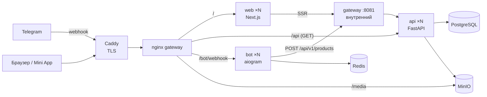

# Каталог товаров: Telegram-бот + Mini App

Администратор добавляет товар в боте (фото и название одним сообщением), пользователи смотрят каталог на Next.js — в браузере или прямо в Telegram как Mini App.

| Компонент   | Стек                                        |
|-------------|---------------------------------------------|
| Фронтенд    | Next.js 16 (App Router), React 19, TypeScript |
| Бэкенд      | FastAPI, SQLAlchemy 2 (async), Alembic      |
| Бот         | aiogram 3, Redis (FSM, дедупликация)        |
| База данных | PostgreSQL 17                               |
| Хранилище   | MinIO (S3)                                  |
| Шлюз        | nginx (балансировка), Caddy (TLS)           |

## Архитектура



Все прикладные сервисы (`api`, `bot`, `web`) **stateless** и по умолчанию запускаются в двух экземплярах. Состояние живёт только в PostgreSQL, MinIO и Redis.

### Как обеспечена отказоустойчивость

**Шлюз (nginx).** Апстримы объявлены с `resolve`: nginx сам подхватывает новые и пропавшие реплики через DNS Docker, без перезагрузки. Если реплика упала или перезапускается, запрос уходит на следующую (`proxy_next_upstream`). Неидемпотентные запросы повторяются только там, где это безопасно (см. ниже).

**API.**
- В процессе ничего не хранится: сессии БД — на запрос, изображения — в S3.
- Миграции и создание бакета выполняет отдельный одноразовый сервис `migrate`, а не каждая реплика при старте. Дополнительно миграции берут `pg_advisory_xact_lock`, так что даже параллельный запуск безопасен.
- Создание товара идемпотентно: бот передаёт `Idempotency-Key` (`tg:<chat_id>:<message_id>`), на ключ стоит уникальный индекс. Повтор запроса — на ту же или другую реплику, последовательно или одновременно — вернёт уже созданный товар, дубля не будет.
- Сначала загружается файл, потом пишется строка в БД; при ошибке файл удаляется. В каталоге не бывает «битых» карточек.
- Пагинация по ключу (`created_at, id`), курсор не привязан к реплике.
- `/health/live` и `/health/ready` (проверяет БД и S3).

**Бот.**
- Webhook-режим: Telegram шлёт обновления на шлюз, шлюз распределяет их по репликам.
- FSM хранится в Redis — можно нажать «Создать товар» на одной реплике, а фото обработает другая.
- Каждое обновление обрабатывается ровно один раз: реплика «забирает» `update_id` в Redis (`SET NX`). Повторная доставка от Telegram (таймаут, сбой) на другую реплику будет пропущена. Если обработка упала, метка снимается, и повтор пройдёт.
- Ответ Telegram отправляется после обработки, поэтому при падении реплики посреди запроса Telegram повторит обновление и его обработает другая.
- Настройка вебхука, команд и кнопки меню — отдельный одноразовый сервис `bot-setup`.
- Есть и polling-режим (для разработки без HTTPS). В нём реплики выбирают лидера через Redis: `getUpdates` вызывает только лидер, остальные в горячем резерве и подхватывают работу за ~15 секунд, если лидер пропал.

**Web.**
- Страница рендерится на каждый запрос (`connection()`), без ISR и без дискового кеша.
- Встроенный оптимизатор картинок выключен (у него локальный дисковый кеш), изображения отдаёт шлюз из S3 с `Cache-Control: immutable` и проксирующим кешем.

## Быстрый старт (локально)

Нужен Docker с Compose v2.

```bash
cp .env.example .env
# заполнить BOT_TOKEN, ADMIN_IDS и секреты (openssl rand -hex 32)
make up          # или: docker compose up -d --build
```

Каталог откроется на http://localhost. Telegram требует HTTPS для вебхуков и Mini App, поэтому без домена бота удобно запускать в режиме `BOT_MODE=polling`, а адрес каталога пробросить через любой HTTPS-туннель.

## Деплой на VPS

1. Установить Docker: `curl -fsSL https://get.docker.com | sh`.
2. Направить A-запись домена на IP сервера, открыть порты 80 и 443.
3. Склонировать репозиторий и подготовить окружение:
   ```bash
   git clone https://github.com/bug1vuge/INVIX-bot.git && cd INVIX-bot
   cp .env.example .env
   nano .env
   ```
   Обязательно: `DOMAIN`, `PUBLIC_URL=https://<домен>`, `BOT_TOKEN` (от @BotFather), `ADMIN_IDS` (свой id можно узнать у @userinfobot), `WEBHOOK_SECRET`, `SERVICE_TOKEN`, `POSTGRES_PASSWORD`, `MINIO_ROOT_PASSWORD`.
4. Запустить с TLS:
   ```bash
   make up-prod     # docker compose -f compose.yaml -f compose.prod.yaml up -d --build
   ```
   Caddy сам выпустит сертификат Let's Encrypt. Сервис `bot-setup` зарегистрирует вебхук, команды и кнопку «Каталог» в меню бота.
5. Проверить: `make ps` — все сервисы `healthy`, `migrate` и `bot-setup` завершились с кодом 0.

Обновление: `git pull && make up-prod`. Миграции применятся автоматически перед стартом API.

## Проверка отказоустойчивости

```bash
# увеличить число реплик на лету
make scale api=3 bot=3 web=3

# убить одну реплику каждого сервиса
docker kill catalog-api-1 catalog-bot-1 catalog-web-1

# каталог и бот продолжают отвечать через оставшиеся реплики
curl -s https://<домен>/api/v1/products | head -c 300

# вернуть реплики обратно
docker start catalog-api-1 catalog-bot-1 catalog-web-1
```

В логах шлюза (`make logs s=gateway`) видно, по каким репликам расходятся запросы — поле `upstream`.

## Как пользоваться ботом

- Любое сообщение или `/start` — бот отвечает «У меня есть товар» и кнопкой «Открыть каталог» (Mini App).
- Администратор (id из `ADMIN_IDS`): кнопка «Создать товар» или `/create`, затем фото с названием в подписи. Можно и сразу отправить фото с подписью — без кнопки. `/cancel` или «Отмена» — выйти из режима добавления.
- Поддерживаются фото и изображения, отправленные файлом (JPEG, PNG, WebP). Формат проверяется по содержимому, а не по расширению.

## API

| Метод | Путь                     | Описание |
|-------|--------------------------|----------|
| GET   | `/api/v1/products`       | Список, новые сверху. `limit` (≤100), `cursor` |
| GET   | `/api/v1/products/{id}`  | Один товар |
| POST  | `/api/v1/products`       | `multipart/form-data`: `name`, `image`. Требует `Authorization: Bearer <SERVICE_TOKEN>`, принимает `Idempotency-Key` |
| GET   | `/health/live`, `/health/ready` | Проверки живости и готовности |

Публично наружу открыты только `GET`-запросы к API. Запись возможна лишь через внутренний порт шлюза, который не публикуется на хост.

## Структура

```
services/
  api/     FastAPI: модели, миграции, работа с S3, тесты
  bot/     aiogram: хендлеры, Redis FSM, дедупликация, выбор лидера, тесты
  web/     Next.js: страница каталога, интеграция с Telegram Web App
deploy/
  nginx/   шлюз: балансировка, кеш изображений, внутренний listener
  caddy/   TLS
compose.yaml        весь стек
compose.prod.yaml   добавляет TLS-edge
```

## Разработка

```bash
cd services/api && uv sync && uv run pytest     # TEST_DATABASE_URL=postgresql+asyncpg://... для Postgres
cd services/bot && uv sync && uv run pytest
cd services/web && npm ci && npm run dev
make lint
```

CI (GitHub Actions) прогоняет линтеры и тесты всех сервисов, тесты API — на PostgreSQL, проверяет миграции в обе стороны, конфиги nginx/Caddy/Compose и собирает Docker-образы.
